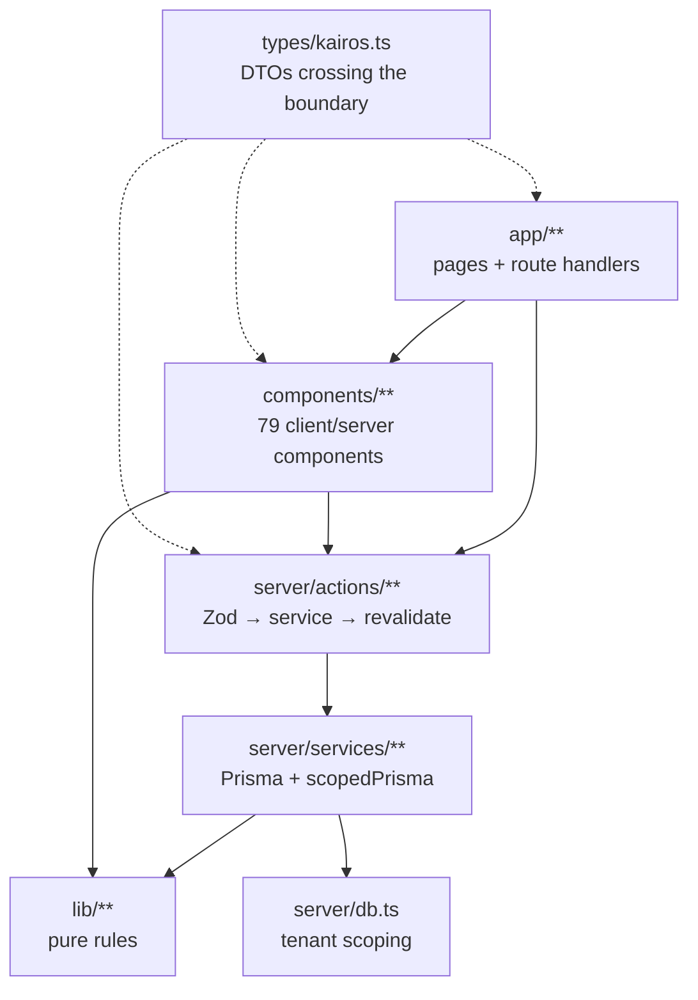

# Architecture review — how features connect

Status: **analysis**, 2026-10-18. No code changes proposed here have been made,
except the one already shipped while writing this (`lib/categories.ts`, §6.2).

The question behind this review was: *"every feature is connected with OOP"* —
refactoring for stability, as a prerequisite for other work. This document takes
that seriously but answers it honestly: the risk in this codebase is **not a lack
of classes**, it is a set of **implicit contracts** between features. The plan
below turns those into explicit ones, and uses object-like constructs (value
objects, ports, a request context) where they buy safety rather than ceremony.

---

## 1. What the architecture is today



| Layer | Size | Rule it already follows |
| --- | --- | --- |
| `src/lib/**` | 3 503 lines | pure, no I/O, unit-tested |
| `src/server/services/**` | 2 592 lines | the only place that touches Prisma |
| `src/server/actions/**` | 527 lines | validate with Zod, call a service, `revalidateApp()` |
| `src/components/**` | 79 `.tsx` | optimistic UI via `useOptimistic`, rollback on failure |

Three things are genuinely well-designed and should be preserved:

1. **`scopedPrisma` (`src/server/db.ts`)** — tenancy is enforced in one query
   hook, not by remembering `where: { userId }` in 60 places.
2. **`views.ts` generic over `TaskLike`** — one grouping engine drives the task
   list, the sidebar counters and the progress panel, so the numbers cannot
   disagree with the list.
3. **Injectable delivery** — `broadcastDailyReminder({ sender })` lets the
   integration suite exercise claiming and retries without a push service. That
   is the pattern to copy.

---

## 2. Findings

Severity is about how likely a change is to silently break something else.

| # | Severity | Finding | Consequence |
| --- | --- | --- | --- |
| A1 | **High** | `server/services/tasks.ts` is 777 lines: create, update, delete, reorder, status, subtree rules, clearing | Every task-shaped feature edits the same file; merge conflicts and accidental cross-feature changes |
| A2 | **High** | `TaskEvent.metadata` is untyped JSON whose shape is a convention (`{habitId, habitDate}`, `{parentId}`, `{subtask, count, via}`) | Habit streaks, statistics and the grid all depend on keys written by three different writers. Rename one key and history silently reads as "nothing happened" |
| A3 | **High** | `TENANT_MODELS` in `db.ts` is a hand-maintained `Set` | Forgetting to add a new model leaks cross-tenant reads. `PushSubscription` had to be added by hand this week |
| A4 | Medium | Features import each other's services freely: `statistics` → `tasks` + `taxonomy` + `events`, `examples` → `tasks` + `habits`, `backup` → everything | No way to see a feature's real dependencies; a change in `tasks` can break statistics at runtime, not at compile time |
| A5 | Medium | `ServiceError` lives in `services/tasks.ts` and is imported by `services/push.ts` and every action | The error model depends on the task feature; deleting or moving tasks breaks unrelated code |
| A6 | Medium | `AppData` context is a wide, mutable contract (settings, today, categories, counts, email, authEnabled) | Any shell-level addition touches the layout and every consumer; `useSearch`/`usePanelState`/`useAppData` are three contexts in one file |
| A7 | Medium | `habits.ts` mixes three concerns: instance generation (a write), board assembly (a read model) and month/trend maths re-exported from `lib` | The file is the only place that knows both scheduling and presentation; hard to test the scheduler alone |
| A8 | Low | Constants drift: `UNCATEGORIZED_LABEL` existed but was unused; statistics had its own `{id: null, name: "Uncategorized"}` | Two answers to "which category is this?" — exactly what filters then tripped over |
| A9 | Low | No dependency-direction enforcement in ESLint | Nothing stops `lib` importing a server module, or a component importing Prisma types |

---

## 3. Research grounding

- **Pure core, imperative shell** (Gary Bernhardt): keep decisions in pure
  functions, keep I/O at the edges. Kairos already does this in `lib/`; the
  finding is that the *contracts between* those layers are implicit.
- **Value objects over primitives**: an `id` that means "user id" and an `id`
  that means "category id" are both `string` today. Branded types make that
  distinction free at compile time (TypeScript `unique symbol` branding).
- **Ports & adapters** without a framework: an interface + one adapter is enough.
  `sender` in the push broadcast is already that pattern.
- **OWASP / Next.js guidance** on keeping server-only modules out of client
  bundles (`server-only`) — relevant because `lib/**` is imported from both
  sides, so a stray Prisma import would either break the build or ship a secret
  check to the browser.

---

## 4. The OOP question, answered concretely

"Make everything OOP" would be a rewrite with no observable benefit: React
components are already the object *boundary*, and Prisma already models the data.
What the codebase lacks are the four things OOP is actually good for:

| OOP idea | Cheap form here | Payoff |
| --- | --- | --- |
| Encapsulation | private module boundaries (`services/tasks/index.ts` re-exports only the public API) | A feature can be split internally without touching callers |
| Value objects | `lib/categories.ts` (`UNCATEGORIZED_ID`, `categoryKey`), branded `UserId`, `DateOnly` | Impossible states become unrepresentable; the filter bug that started this review is a value-object bug |
| Interfaces | `PushSender`, `TaskRepository` (only where a second implementation exists: tests) | Deterministic tests without a database or a push service |
| Inheritance | **not needed** — there is no hierarchy in this domain | — |

The one genuinely object-shaped refactor worth doing is a **request context**:

```ts
// src/server/context.ts (proposed)
export type RequestContext = {
  readonly userId: UserId;            // branded: cannot be confused with a category id
  readonly email: string | null;
  readonly settings: SettingsRecord;
  readonly today: string;             // date-only in the account's timezone
};
```

Today every service takes `userId: string` first and every action re-derives
`today` from settings. One context object, created once in `requireAuthProfile()`
and passed down, removes ~20 repeated derivations and makes "which tenant is
this?" impossible to get wrong.

---

## 5. Refactor roadmap

Phases are ordered so each one is shippable in a day and independently valuable.
Nothing here changes behaviour; the 228 unit tests plus the isolation suite are
the safety net, and every phase should end greener than it started.

### Phase 1 — extract without moving (low risk)

1. `src/server/errors.ts` — move `ServiceError`, re-export from `services/tasks`
   for compatibility, update imports mechanically (removes A5).
2. `src/server/services/tasks/` — split `index.ts`, `query.ts`, `write.ts`,
   `tree.ts`, `status.ts`. `index.ts` re-exports the current names, so **no
   call site changes** (removes A1).
3. Type the event metadata (removes A2):

   ```ts
   // src/lib/events.ts (proposed, pure)
   export type TaskEventMetadata =
     | { kind: "created"; parentId: string | null }
     | { kind: "habit"; habitId: string; habitDate: string }
     | { kind: "subtasks"; count: number; via: "parent" }
     | { kind: "moved"; from: string | null; to: string | null };
   ```

   Write through the type; parse on read with a Zod schema and **drop** unknown
   payloads instead of throwing, so old rows stay readable.

### Phase 2 — make contracts explicit

**Done 2026-10-19:** the request context (`lib/request-context.ts` +
`server/context.ts`) now supplies `userId`, `email`, `settings`, `timeZone` and
`today` once per request, and the habits/statistics services take it instead of
re-deriving the account's clock. Remaining in this phase: the schema-derived tenancy
check (done in Phase 0), the ESLint import rules, and the `AppData` split.

4. **Schema-derived tenancy test** (removes A3 permanently):

   ```ts
   // tests/unit/tenancy.test.ts
   // Every model that has a userId column must be listed in TENANT_MODELS.
   // Parse prisma/schema.prisma, collect `model X { … userId … }`, compare.
   ```

   This is a 30-line test that makes a whole class of leak impossible.
5. `RequestContext` (§4) threaded from `requireAuthProfile()` into services.
6. ESLint `no-restricted-imports`: `lib/**` may not import `server/**`;
   `components/**` may not import `@prisma/client`; services may not import
   `components/**`. Three rules, one commit (removes A9).
7. Split `AppData` contexts into `SettingsContext`, `CategoriesContext`,
   `CountsContext` — or keep one shape but expose narrow hooks
   (`useCategories()`) so consumers stop depending on the whole object (removes A6).

### Phase 3 — feature modules

8. `src/features/<name>/` with `index.ts` as the only public door; statistics
   consumes `tasks/public` instead of the service internals (removes A4).
9. Split `services/habits.ts` into `schedule.ts` (generation) + `board.ts` (read
   model), both fed by pure rules in `lib/habits.ts` (removes A7).
10. Generalise the `sender` injection pattern: `TaskRepository` interface used by
    actions and faked in unit tests.

### Explicitly **not** on the roadmap

- Class-based entities (`class Task { … }`) — they would duplicate Prisma and add
  serialisation work at every boundary.
- A repository layer that only forwards to Prisma for every model — indirection
  with no second implementation and no tests to gain.
- Rewriting working pure rules as objects.

---

## 6. What was already fixed while writing this

### 6.1 The category-identity bug (A8, resolved)

`null` category meant "no category" in the database, "not counted" in
`byCategory`, `{id: null}` in statistics, and "unfilterable" in the UI. Now:

- `src/lib/categories.ts` — `UNCATEGORIZED_ID` (cannot collide with a cuid),
  `categoryKey()`, `categoryLabel()`;
- `buildViewCounts().byCategory` counts the bucket instead of skipping it;
- statistics uses the same id, so the donut and the filter agree;
- `TaskFilters` carries `categoryId: string | null` where the sentinel is a real
  value, and All Tasks has a category filter (`TaskToolbar`).

This is the pattern for the rest of the review: **one answer per question,
expressed once, in `lib/`.**

### 6.2 Local vs production implications

- Every module-level cache is per serverless instance. Nothing in `lib/` may hold
  request state; the proposed `RequestContext` is created per request for exactly
  this reason.
- `server-only` protects the boundary at build time: if a refactor moves a
  Prisma import into `lib/`, the build fails instead of shipping a broken bundle.
  Keep `serverExternalPackages` (`@prisma/client`, `prisma`, `web-push`) in sync
  with any new native dependency.
- The verification loop for every phase is the same in both environments:
  `typecheck` → `lint` → 228 unit → 25 integration → build → `/api/health`.

---

## 7. Measurable exit criteria

| Metric | Today | Target |
| --- | --- | --- |
| Largest service file | 189 lines (`tasks/edit.ts`), was 777 | < 250 |
| Hand-maintained tenancy list | 6 entries, by hand | generated + test-enforced |
| Untyped JSON contracts crossing features | 0 (`TaskEvent.metadata` is typed and parsed) | 0 |
| Places that derive "today" from settings | 6, was 8 | 0 |
| Cross-feature service imports | 8 | 0 outside a feature's `index.ts` |
| "Where does this rule live?" ambiguous cases | `UNCATEGORIZED_LABEL` was one | 0 known |
| Unit tests | 228 | ≥ 260 after Phase 2 |

---

## 8. Open questions

1. Is `TaskEvent.metadata` ever read by anything outside this repo (exports,
   external dashboards)? That decides whether old payloads must be preserved
   verbatim or can be migrated once.
2. Should a `UserId` brand be introduced now (touches every service signature) or
   only as part of Phase 2's `RequestContext`?
3. Are there other consumers of `AppData` planned (mobile, Tauri)? That would
   argue for the narrower-hooks split sooner.
