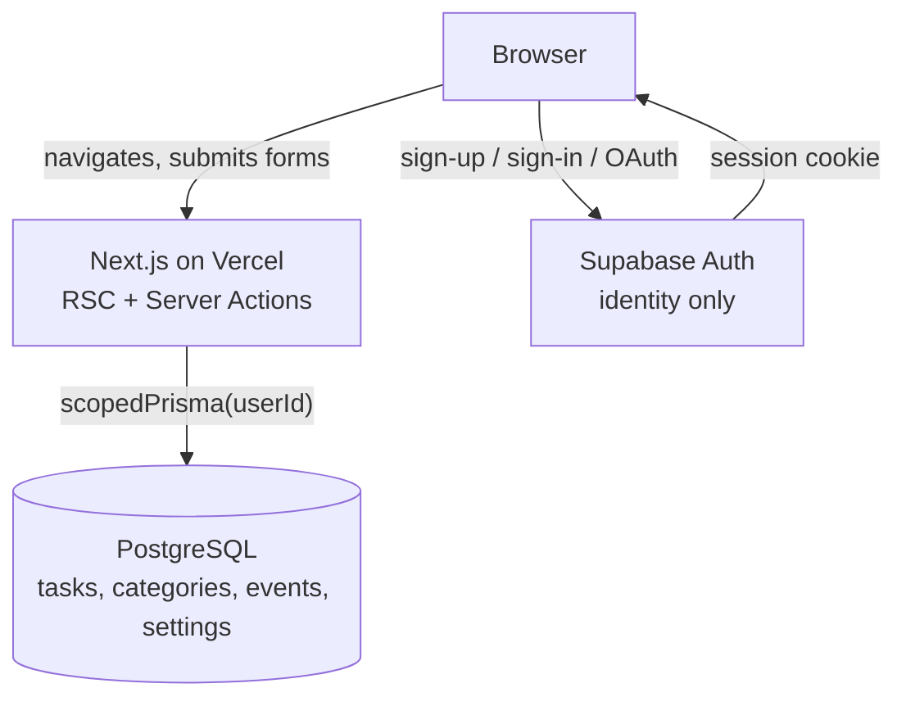
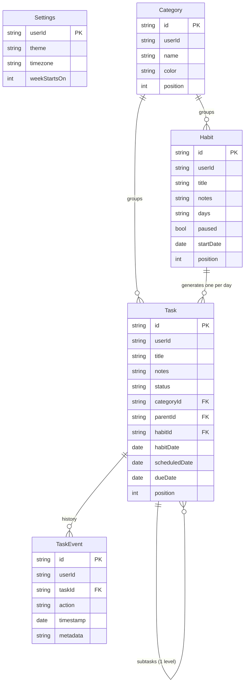

# Kairos — project context

Everything about this project as of **2026-10-08**: what it is, how it is built,
where it runs, what has been decided, what has broken, and what is left.

This is the **state of the project** document. For *how to deploy it*, read
[README.md](README.md) instead — that is the guide; this is the reference.

---

## Contents

1. [What Kairos is](#1-what-kairos-is)
2. [Status at a glance](#2-status-at-a-glance)
3. [Architecture](#3-architecture)
4. [Data model](#4-data-model)
5. [Multi-tenancy: how isolation works](#5-multi-tenancy-how-isolation-works)
6. [Authentication and the gate](#6-authentication-and-the-gate)
7. [Route areas and access](#7-route-areas-and-access)
8. [Code map](#8-code-map)
9. [Environment variables](#9-environment-variables)
10. [Local development](#10-local-development)
11. [Testing](#11-testing)
12. [Live infrastructure](#12-live-infrastructure)
13. [Timeline of decisions](#13-timeline-of-decisions)
14. [Failure log and lessons](#14-failure-log-and-lessons)
15. [Limitations and not-yet-built](#15-limitations-and-not-yet-built)
16. [Open items](#16-open-items)
17. [Command reference](#17-command-reference)
18. [Profiles, avatars, category icons and text size](#18-profiles-avatars-category-icons-and-text-size)
19. [Habits](#19-habits)

---

## 1. What Kairos is

An open-source, self-hosted task manager. It organises work by **category and
date**, breaks tasks into **one level of subtasks**, and shows where progress
comes from with a statistics page.

The name is the Greek *καιρός* — the right, opportune moment to act.

**Product shape today:** a multi-user web app. Anyone can register with email or
Google, and each account gets a **private workspace**. There is no sharing, no
teams and no collaboration — accounts are individual by design.

| | |
| --- | --- |
| License | MIT |
| Audience | anyone who wants a focused task list without an account on someone else's service |
| Model | free to use; each user's data is theirs alone |

---

## 2. Status at a glance

| Area | State |
| --- | --- |
| **Application** | feature-complete for the described scope, deployed and reachable |
| **Multi-user isolation** | implemented and tested (10 integration tests) |
| **Habits** | implemented — a repeating task is generated into Today each day it is due, with a monthly grid, a 30-day trend, and "done" derived from the task's history |
| **Auth** | Supabase — email/password **and** Google, both enabled and working |
| **Database** | PostgreSQL (Prisma Postgres) — migrated, in sync with the schema |
| **Production** | builds and serves; gate verified on the live URL |
| **Unit tests** | 206 passing |
| **Integration tests** | 10 passing |
| **Typecheck / lint** | clean |
| **Account deletion** | ❌ not built — see [§15](#15-limitations-and-not-yet-built) |
| **Rate limiting** | ❌ not built |
| **Privacy policy / terms** | ❌ not written |

**Working tree:** documentation and one config change are uncommitted; there is
one **dead file** to remove (see [§16](#16-open-items)).

---

## 3. Architecture

### Stack

| Concern | Choice | Installed |
| --- | --- | --- |
| Framework | Next.js App Router, React Server Components | `next` 15.5.27 |
| UI runtime | React | 19.3.0 |
| Language | TypeScript | 5.9.3 |
| Styling | Tailwind + shadcn/ui, Lucide icons, Poppins | `tailwindcss` 3.4.19 |
| ORM | Prisma | `prisma` / `@prisma/client` 6.19.3 |
| Database | PostgreSQL | Prisma Postgres (managed) |
| Auth | Supabase Auth via `@supabase/ssr` | 0.12.7 |
| Mutations | Server Actions + Zod validation + optimistic UI | `zod` 3.24 |
| Drag and drop | dnd-kit (pointer **and** keyboard sensors) | `@dnd-kit/core` 6.3.1 |
| Charts | Recharts | 2.15 |
| Dates | date-fns | 4.1 |
| Unit tests | Vitest | 2.1.9 |
| E2E tests | Playwright | 1.49.1 |
| Package manager | **Bun** (not npm) | 1.3.x |

### Runtime shape

The browser talks to **two** backends, and it is worth being precise about which
does what:



- **Task data never touches Supabase.** All reads and writes go through Server
  Components and Server Actions on the Next.js server.
- **Supabase only establishes identity.** The browser talks to it directly for
  sign-in (which is why `NEXT_PUBLIC_SUPABASE_URL` must be reachable from the
  browser and allowed in the CSP).
- **There is no separate backend**, no React Router and no TanStack Query — the
  app is deliberately Server-Component-first, with Client Components only for
  interaction (drag and drop, dialogs, optimistic updates).

### Where it runs

| Layer | Service | Identifier |
| --- | --- | --- |
| Hosting | Vercel | project `kairos`, team `mahmoud-aths-projects` |
| Production URL | Vercel | `https://kairos-zeta-ivory.vercel.app` |
| Database | Prisma Postgres | pooled host for the app, direct host for migrations |
| Auth | Supabase | project ref `jexeakhohftqqwfjeqkd` |

---

## 4. Data model

Four tables, all owned by a user. Defined in `prisma/schema.prisma`.



Design points worth knowing:

- **`status` is a string** (`TODO` | `DONE`), validated at the application
  boundary in `src/lib/validation.ts`, not by a database enum.
- **Date-only values** (`scheduledDate`, `dueDate`) are stored as **UTC
  midnight** so they are timezone independent. Event timestamps are real UTC
  instants.
- **Subtasks are one level deep**, enforced in `src/lib/task-rules.ts`. A
  subtask always shares its parent's owner and cannot be reparented across
  users.
- **`Category.name` is unique per user**, not globally — two people may both
  have a category called "Work".
- **`Settings` is keyed by `userId`** (it was a fixed single row before
  multi-user).
- **Every index leads with `userId`**, because every query filters on it.
- `TaskEvent` records history: `created`, `completed`, `reopened`, `deleted`,
  `moved`, `updated`.
- Labels and priorities were **removed from the product**; a task is grouped by
  its category and dates.

### Migrations

```
prisma/migrations/
  20261006120000_init                   ← squashed Postgres schema
  20261008120000_multi_user_scoping     ← adds userId to every table
  20261011120000_profile_and_category_icon
  20261011130000_text_scale
  20261012120000_habits                 ← adds Habit + Task.habitId/habitDate
```

The `init` migration is a **squashed** one: the original SQLite migrations were
replaced with a single Postgres init when the database changed. The multi-user
migration **drops and recreates** all four tables — destructive by design,
approved pre-launch when there was no data to preserve.

---

## 5. Multi-tenancy: how isolation works

This is the most important design decision in the codebase.

**Isolation is enforced in the query layer, not the UI.** Every service function
receives a `userId` and builds its client from `scopedPrisma(userId)`:

```ts
// src/server/db.ts
export function scopedPrisma(userId: string) { … }
```

`scopedPrisma` is a Prisma `$extends` query hook over
`TENANT_MODELS = { Task, Category, TaskEvent, Settings }` that injects `userId`:

- into **`where`** for reads, updates and deletes
- into **`data`** for `create`, `createMany` and `upsert`

Three properties make this trustworthy:

1. **It fails closed.** An empty `userId` throws rather than returning an
   unscoped query.
2. **The tenant can only come from the session.** `requireUserId()` in
   `src/server/auth.ts` is the single place a user id is established, and it
   always reads the verified Supabase session — never a request body, query
   string or form field. Callers cannot supply their own id.
3. **Creates still name `userId` explicitly.** The scoped client is cast to
   `PrismaClient` to preserve normal result typing, so `data` is not rewritten
   in a way TypeScript hides. This is deliberate: ownership is auditable at every
   write site.

**Service convention:** every function takes `userId` first and then does
`const prisma = scopedPrisma(userId);`. Query bodies stay unchanged, and helpers
that participate in a transaction take a `ScopedTx`.

**Known limitation (documented, accepted):** the extension hooks apply to
top-level operations only, so relations loaded via `include` (subtasks) are not
independently filtered. This is safe because a subtask always shares its parent's
owner and cannot be reparented across users.

**Proof:** `tests/integration/isolation.test.ts` exercises this against a real
PostgreSQL with random tenant ids — 10 tests covering reads, writes, updates,
deletes, aggregates and settings.

---

## 6. Authentication and the gate

### The gate is on by default and fails closed

```ts
// src/server/auth.ts
export function isAuthDisabled(): boolean {
  return process.env.KAIROS_AUTH_DISABLED === "true";
}
```

This was originally **fail-open** — it disabled itself whenever Supabase was not
configured, which is reasonable for a private single-user app and dangerous for a
public multi-user one. It was inverted. Now:

| Situation | Behaviour |
| --- | --- |
| Configured | real gate: session required, `/login` for signed-out visitors |
| Not configured, not explicitly disabled | **refuses to serve** with an actionable error on every route, `/api/health` included |
| `KAIROS_AUTH_DISABLED=true` | gate off; everyone shares one `local` workspace |

### Flow

- **`/register`** and **`/login`** are separate pages sharing one component
  (`src/components/auth/auth-form.tsx`, with a `mode` prop). Google appears on
  both — Supabase treats the first use as sign-up and later uses as sign-in.
- **`/auth/callback`** is a Route Handler (not a Server Component) because it
  must set cookies when exchanging the OAuth or email `code` for a session.
- **`src/middleware.ts`** refreshes the session and redirects:
  - `PUBLIC_PATHS = ["/api/health", "/auth/callback"]`
  - `AUTH_PATHS = ["/login", "/register"]` — signed-in users are sent to `/today`
  - `/` (landing) is served before the config check; **if** a Supabase session
    cookie is present it is verified once and the visitor is sent to `/today`,
    so a signed-in user never sees the marketing page or the sign-in form again
  - signed-out visitors go to `/login?next=…`, guarded by `safeNextPath()` in
    `src/lib/auth-rules.ts` against open redirects
- `KAIROS_ALLOWED_EMAILS` is an **allow-list for a private deployment**. On a
  public app it must stay unset, or every other account is signed straight back
  out.

---

## 7. Route areas and access

The app is one application with **three route groups**. A parenthesised group is
organisational only — it contributes no URL segment — so every existing URL is
unchanged.

| Area | Directory | Layout provides | Owns |
| --- | --- | --- | --- |
| Marketing | `src/app/(marketing)/` | public navbar + footer | `/` |
| Authentication | `src/app/(auth)/` | full-screen centring frame | `/login`, `/register` |
| Application | `src/app/(app)/` | sidebar + workspace shell (`AppShell`) | `/today`, `/tasks`, … |

`src/app/layout.tsx` stays minimal: `<html>`/`<body>`, fonts, global CSS and the
site-wide metadata. It performs **no** session lookup and **no** query, which is
what lets the landing page be statically rendered.

### Routes

| Route | Area | Access |
| --- | --- | --- |
| `/` | marketing | **public**, statically rendered — no session and no Supabase configuration required |
| `/login` | auth | public, `noindex` |
| `/register` | auth | public, indexable, listed in `sitemap.xml` |
| `/today`, `/tasks`, `/completed`, `/categories/[id]`, `/statistics`, `/settings`, `/habits` | app | **session required**, `noindex` |
| `/auth/callback` | root | public — it sets the session cookie and must never be redirected |
| `/api/health` | root | public — uptime checks run before a session exists |
| `/api/cron/daily-reminder` | root | **public, and secret-authenticated** — a scheduler has no session; see §20 |
| `/api/backup` | root | session required |
| `robots.txt`, `sitemap.xml`, `icon.svg`, `sw.js`, `manifest.webmanifest` | root | static (`/api/` and the workspace views are `noindex`; `sw.js` is exempt from the gate by the middleware matcher, since a browser cannot register a script it is not allowed to fetch) |

### The access matrix

Classification lives in `src/lib/auth-rules.ts` as pure functions
(`isPublicPath`, `isAuthPath`), so the middleware and the unit tests apply exactly
the same rules and the matrix is testable without standing up Supabase.

| Request | Result |
| --- | --- |
| `/` | served, always — signed in or out, configured or not |
| `/` with a session cookie, Supabase configured | `307` → `/today` (verified once; a cookie that turns out to be invalid just renders the page) |
| signed out → protected route | `307` → `/login?next=<path>` |
| signed out → unknown path | `307` → `/login?next=…` — **fails closed**, not open |
| signed in → `/login` or `/register` | `307` → `/today` |
| signed in, email not allowed | session dropped → `/login?error=not_allowed` |
| auth enabled but Supabase unconfigured | `500` config error on everything **except** `/` |
| `KAIROS_AUTH_DISABLED=true` | no gate at all (local development, Playwright) |

Every entry is matched **exactly**, never by prefix: `/api/healthy-looking` does
not inherit `/api/health`'s exemption, and `/registering` is not an auth page. A
trailing slash is ignored, because Next redirects it anyway.

---

## 8. Code map

```
src/
  app/
    (marketing)/      public landing page + navbar/footer layout
    (auth)/           login, register + centring layout
    (app)/            authenticated shell: today, tasks, completed, categories,
                      statistics, settings + error/loading boundaries
    api/              health, backup
    auth/callback/    OAuth + email code exchange
  components/
    auth/             auth-form (icons, password reveal, spinner), auth-shell
    marketing/        brand, nav, site-header (+ theme toggle), site-footer,
                      hero, app-preview, features, how-it-works, faq, final-cta
    tasks/            workspace, rows, sections, toolbar, quick-add, optimistic
    layout/           app-shell, sidebar, theme-toggle, theme-sync,
                      shortcut-provider, shortcut-dialog, progress-panel
    settings/         profile-panel (identity + theme), theme-picker,
                      preferences-form (dates), taxonomy-manager, backup-panel
    habits/           habits-view (grid + trend + config list), habit-month-grid,
                      habit-trend (+ chart), habit-dialog, charts (lazy Recharts)
    categories/ dnd/ statistics/ taxonomy/ ui/
  lib/
    auth-rules.ts     allowedEmails, isEmailAllowed, safeNextPath
    habits.ts         cadence, streaks, completion rate, month/trend rules (pure)
    push.ts           the reminder's wording, tags, key shapes, delivery outcomes (pure)
    shortcuts.ts      the key table + resolveShortcut() (pure, unit tested)
    task-rules.ts     subtask rules
    validation.ts     Zod schemas
    dates.ts filters.ts ordering.ts stats.ts views.ts constants.ts site.ts
  server/
    auth.ts           the gate; requireAuthProfile() → requireUserId()
    cron-auth.ts      constant-time check of the scheduler's shared secret
    db.ts             prisma + scopedPrisma(userId)
    serializers.ts    DB rows -> client types
    actions/          Server Actions (tasks, taxonomy, settings, backup, auth, examples, push)
    services/         all data access: tasks, taxonomy, settings, events,
                      statistics, backup, examples, habits, push
  middleware.ts       session refresh + access gate
  types/kairos.ts     shared types
public/sw.js          the notification service worker (no fetch handler)
tests/
  unit/               16 files, 206 tests
  integration/        isolation.test.ts + push.test.ts, 22 tests + setup guard
  e2e/                Playwright: task workflow, drag and drop, backup
```

**~140 source files**, 8 Server Action modules, 9 services, 3 API routes.

---

## 9. Environment variables

| Variable | Required | Purpose |
| --- | --- | --- |
| `DATABASE_URL` | ✅ | PostgreSQL connection the app uses. **Pooled** host in production |
| `DIRECT_URL` | ✅ for migrations | direct connection, used by the Prisma CLI only |
| `NEXT_PUBLIC_SUPABASE_URL` | ✅ | Supabase project URL; the gate needs it |
| `NEXT_PUBLIC_SUPABASE_ANON_KEY` | ✅ | public anon / publishable key |
| `NEXT_PUBLIC_APP_URL` | recommended | absolute origin for canonical links, sitemap, social metadata |
| `KAIROS_ALLOWED_EMAILS` | ❌ leave unset | allow-list for a *private* deployment |
| `KAIROS_AUTH_DISABLED` | no | `true` removes the gate — **local development only** |
| `KAIROS_NO_INDEX` | no | `true` serves `Disallow: /` to crawlers |
| `NEXT_PUBLIC_VAPID_PUBLIC_KEY` | no | public half of the VAPID pair; the only push value handed to the browser |
| `VAPID_PRIVATE_KEY` | no | private half — server-side only, never logged or sent to a client |
| `VAPID_SUBJECT` | no | `mailto:` contact the push services can use |
| `KAIROS_CRON_SECRET` | no | shared secret the scheduler authenticates with. On Vercel name it `CRON_SECRET` instead, so the `Authorization` header is attached automatically. With none set, every call to the cron route is refused |
| `PORT` | no | local/Docker only; Vercel manages it |

**Two rules that cause most problems:**

1. **`NEXT_PUBLIC_*` is inlined at build time.** Changing one requires a new
   build, not a restart. The CSP in `next.config.ts` is also compiled from
   `NEXT_PUBLIC_SUPABASE_URL`, so a stale value silently blocks every Supabase
   call and surfaces in the browser as a bare **"Failed to fetch"**.
2. **A real environment variable beats a `.env` file.** An `export` in your shell
   overrides `.env.local` for as long as that shell lives.

Files: `.env` (local database), `.env.local` (local Supabase, gitignored),
`.env.example` (template). Production values are **not** in the repository: they
live in `~/.config/kairos/production.env` (mode 600) and reach a command only via
`scripts/with-prod-env.sh`.

---

## 10. Local development

```bash
bun install
bunx prisma migrate deploy     # create the tables
bun run dev
```

Requires a PostgreSQL database and a Supabase project — the gate fails closed, so
missing config shows an error rather than opening the app.

- Put the two `NEXT_PUBLIC_SUPABASE_*` values in `.env.local`, **or**
- set `KAIROS_AUTH_DISABLED=true` to work without sign-in (shared `local`
  workspace).

Two traps:

- **`next start` uses `.env`.** It loaded `.env.production.local` until that file
  was removed from the repository, which is why a local production run used to
  answer `503` from `/api/health`: it was talking to the remote database.
- **Test config-dependent behaviour with a scrubbed environment** or an exported
  variable from earlier will silently win:

  ```bash
  env -u DATABASE_URL -u NEXT_PUBLIC_SUPABASE_URL -u NEXT_PUBLIC_SUPABASE_ANON_KEY bun run dev
  ```

---

## 11. Testing

| Suite | Command | Count | Notes |
| --- | --- | --- | --- |
| Unit | `bun run test` | **206** | pure logic: dates (incl. month maths and `?month=` parsing), filters, ordering, stats (incl. the habit-event exclusion), grouping, subtask rules, habit rules (cadence, streaks, rate, month/trend), push rules (payload, key shapes, statuses, Morocco dates, bounded concurrency), scheduler auth, backup validation, auth rules, avatars, icons, profile, shortcuts |
| Integration | `bun run test:integration` | **22** | real PostgreSQL; proves per-user isolation, and push device ownership, daily duplicate prevention and expired-subscription cleanup |
| E2E | `bun run test:e2e` | — | Playwright; builds first, sets `KAIROS_AUTH_DISABLED=true` |
| Types | `bun run typecheck` | — | `tsc --noEmit` |
| Lint | `bun run lint` | — | ESLint |

**The integration suite has a safety guard.** `tests/integration/setup.ts`
refuses to run against a non-local `DATABASE_URL` unless
`KAIROS_ALLOW_REMOTE_INTEGRATION_DB=true` is set, because the suite writes and
deletes rows. `bun run test:integration` also strips `DATABASE_URL` and
`DIRECT_URL` from the environment so a polluted shell cannot redirect it to
production. This guard exists because it once did exactly that.

The `server-only` package throws outside the react-server condition, so the
integration config aliases it to `tests/integration/server-only.stub.ts`.

---

## 12. Live infrastructure

| | |
| --- | --- |
| Production URL | `https://kairos-zeta-ivory.vercel.app` |
| Vercel project | `mahmoud-aths-projects/kairos` (CLI authenticated, repo linked via `.vercel/`, gitignored) |
| Vercel env vars | `DATABASE_URL`, `DIRECT_URL`, `NEXT_PUBLIC_APP_URL`, `NEXT_PUBLIC_SUPABASE_URL`, `NEXT_PUBLIC_SUPABASE_ANON_KEY` — Production, Preview, Development |
| Supabase project | ref `jexeakhohftqqwfjeqkd` → `https://jexeakhohftqqwfjeqkd.supabase.co` |
| Supabase providers | email ✅ · Google ✅ · sign-ups allowed · `mailer_autoconfirm = true` (no confirmation email needed) |
| Supabase Site URL / redirects | app origin + `http://localhost:3000/**` |
| Google Cloud | OAuth client; redirect URI must be `https://jexeakhohftqqwfjeqkd.supabase.co/auth/v1/callback` |

> **No secrets belong in this file.** Credentials live in the Vercel dashboard,
> the Supabase dashboard, and `~/.config/kairos/production.env` (outside the
> repository, mode 600) — never in the working tree.

**Supabase settings do not carry over between projects.** If the project is ever
recreated, every place the ref appears must be updated — see
[troubleshooting.md §6](troubleshooting.md#6-recreated-your-supabase-project-read-this).

---

## 13. Timeline of decisions

| # | Decision | Why |
| --- | --- | --- |
| 1 | **SQLite → PostgreSQL** | Vercel has no persistent disk. SQLite on serverless is a non-starter |
| 2 | **Prisma Postgres** as the host | Managed, free tier, integrates with Vercel; `binaryTargets` includes `rhel-openssl-3.0.x` for Vercel's Amazon Linux runtime |
| 3 | **Pooled URL for the app, direct URL for migrations** | The pooler cannot hold the stable session migrations need |
| 4 | **Single-user → multi-user** | Product goal changed to a public app where anyone can sign up free |
| 5 | **Isolation in the query layer** (`scopedPrisma`) | Enforced centrally, so a forgotten `where` clause cannot leak another user's rows |
| 6 | **Supabase Auth as identity only** | Task data stays in PostgreSQL; Supabase never sees it |
| 7 | **Google + email sign-in** | Lower friction for a free app |
| 8 | **`/register` and `/login` as separate pages** | Distinct URLs, and a real hand-off after email confirmation, instead of tabs |
| 9 | **Auth gate inverted to fail closed** | The previous fail-open behaviour would expose one shared workspace if a variable went missing |
| 10 | **Migration squashed at the Postgres switch** | The SQLite migrations were not valid Postgres DDL; the hosted database started empty |
| 11 | **No Prisma ORM 8 upgrade** | Prisma's optional GitHub integration asks for it, but ORM 8 replaces the query API, schema format and migration workflow — a full data-layer rewrite for no benefit here |
| 12 | **UI/UX round: theme at the root, shortcuts, minimal workspace** | `ThemeProvider` sat inside the app shell, so the landing and sign-in pages had no theme at all and ignored `prefers-color-scheme`; the dark palette moved to VS Code's "Dark 2026" surfaces (green accent kept), the workspace copy was cut to icons and counts, and a keyboard layer was added |
| 13 | **Habits are a recipe, not a record** | A habit stores only *what repeats* — title, category, the days it is due. Each of those days Kairos generates an ordinary task for it, and "is the habit done today?" is read back from that task. Progress is therefore a *view* over history rather than a second thing to keep in sync, and there is no way for the habit and its tasks to disagree |
| 14 | **A habit day can be corrected from the month grid** | Days get forgotten, and a tracker you cannot correct is a tracker you stop trusting. Tapping a cell writes the same generated task (creating the missed day's instance if it had already been swept away), and un-ticking works because the completion log is *folded* — `reopened` takes a day back off — rather than collected. The event log stays append-only; only the derived view changes |
| 15 | **The grid draws cells and legend from one state map** | The first version styled a cell by whether it was *editable* rather than by what it *meant*, so a missed day read as neutral in the grid and red in the key. One `CELL_CLASS` map per state, used by both, makes that class of drift impossible |
| 16 | **Two-letter weekday headings, a week view under `lg`, and a rich tooltip** | Single letters repeat `T` and `S` twice in a month table; 24 px cells are too small to be a comfortable touch target, so below `lg` the default becomes a week of 44 px controls with the month table one tap away; and the state of a cell is worth spelling out ("Reading · October 12 · Completed") rather than leaving to a `title` bubble |
| 17 | **Habit completions are excluded from task statistics** | Habit instances are quarantined out of every task view, so counting their completions in the activity series would make one page disagree with itself. The habits page is where habit progress is reported |
| 18 | **Example data includes six weeks of habit history** | A tracker is meaningless with an empty grid: streaks, misses and the trend only make sense against history. The sample is hand-written to be imperfect — one habit kept up, one improved, one abandoned — so the UI is exercised on the shapes it has to handle, not on a wall of green |
| 19 | **One generic reminder, at most once per device per day** | A notification that guesses ("3 tasks are late") has to read the database, be right, and is wrong the moment the phone is offline — so the message is one fixed sentence on one shared schedule. Delivery is *at most* once, never exactly once: each device is claimed for the Morocco date before the send, and a transient failure hands the claim back. Vercel documents cron delivery as best effort, so a design that claimed exactly-once would be lying |
| 20 | **The service worker has no `fetch` handler** | A worker that intercepts requests is a cache, and Kairos does not cache authenticated pages: a cached document holds one account's tasks, and a copy that outlives a sign-out is the kind of bug nobody notices until it matters. Two handlers — `push` and `notificationclick` — and nothing else |
| 21 | **`endpoint` is unique across the whole table, and a re-subscribe hands the row over** | A browser profile has one subscription per VAPID key, so a device that changes account must *move* its row rather than add a second one; two rows would send every reminder twice, the second copy to an account that had already switched it off. This is the one write that uses the unscoped client, and it is documented as such in the service |
| 22 | **The reminder hour is a per-account setting, matched against that account's clock** | A job per account is not an option (one shared schedule, and a once-a-day cron), so the hour travels in `Settings` and the broadcast compares it with `hourInTimeZone(now, account.timezone)`. The hour therefore means what a person expects — "8 PM my time" — while the deployment keeps one job. Hours the free daily cron cannot reach need a free hourly scheduler, and the panel says so rather than saving a choice that silently never arrives |

---

## 14. Failure log and lessons

Every one of these cost real time. They are the reason the guide opens with
"five rules".

### Database and migrations

| Failure | Cause | Resolution |
| --- | --- | --- |
| `P1010 User was denied access` | the local PostgreSQL had no `kairos` role | `CREATE ROLE kairos … CREATEDB` |
| `template database "template1" has a collation version mismatch` | glibc upgraded under an existing cluster, blocking every `CREATE DATABASE` | `CREATE DATABASE … TEMPLATE template0` (template0 records no collation version). The canonical fix, `ALTER DATABASE template1 REFRESH COLLATION VERSION`, needs superuser |
| `P1001 Can't reach database server` | the URL still contained placeholders (`USER`, `PASSWORD`, `…`) | copy the real string; never retype it |
| Vercel `500 Application error … Digest: 2414997240` | the real log said `Can't reach database server at localhost:5432` — Vercel still had the local dev URL | set the pooled string in Vercel |
| `column "TaskEvent.userId" does not exist` | a migration was applied to production but not locally | apply migrations to both |
| **Production 500 on every workspace page** (`/tasks`, digest 2837338973, 13 Oct 2026) | the habits code deployed, `20261012120000_habits` did not: `Habit` did not exist and `Task` had no `habitId`/`habitDate`. `ensureHabitInstances()` runs in the app shell, so a missing habit table takes out **every** page, not just `/habits` | `prisma migrate deploy` over the direct host. Diagnosed by reading `information_schema` and `_prisma_migrations` directly rather than guessing from the digest, then reproduced locally (drifted DB → `P2022 The column Task.habitId does not exist`, `/tasks` 500) |
| **`/api/health` stayed green through that entire outage** | the probe selected `Settings` and `Category.icon` — columns that *were* present | extended the probe to read `Task.habitId`/`habitDate` and a `Habit` row, so a missing migration now answers **503**. Proven both ways: drop the column → 503, restored → 200 |
| `bunx prisma migrate deploy` with `DATABASE_URL=…` inline still hit the **wrong database** | the Prisma CLI resolves `.env` over an inline environment variable, so a one-off command silently targets the dev database | inline the URL into a temporary schema instead: `sed -E 's\|env\("[A-Z_]+"\)\|"<url>"\|g' prisma/schema.prisma > prisma/schema.tmp.prisma`, then `--schema prisma/schema.tmp.prisma`, then delete it. **This also means Playwright's `DATABASE_URL="$E2E_DATABASE_URL" prisma migrate reset` may be resetting the dev database — check before running the e2e suite** |
| `Unknown argument 'data'. Did you mean 'update'?` on `prisma.settings.upsert()` | `scopedPrisma`'s extension stamped `userId` into `args.data` for **every** listed operation — but `upsert` has no `data` argument, so every scoped upsert threw and **JSON import and reset were both broken**. The old integration suite missed it because `getSettings` upserts through the *unscoped* client | stamp `create` for upsert, keep `data` for create/createMany, never touch `update`. Pinned by two integration tests (backup round-trip, reset isolation) |

### Process failures

| Failure | Cause | Resolution |
| --- | --- | --- |
| Integration tests **ran against production** | the shell had `DATABASE_URL` exported to Prisma Postgres, so "local" commands targeted the remote database | added the guard in `tests/integration/setup.ts` plus `env -u` in the test script |
| **Three files silently reverted** to their committed state, losing the multi-user edits | `examples.ts`, `statistics.ts` and `(app)/statistics/page.tsx` were absent from `git status` while everything else was modified | re-applied; commit often so a repeat cannot lose work |
| A wrong hypothesis: "the missing `DIRECT_URL` causes the 500" | empirically disproved — Prisma Client does not validate `directUrl`, only the CLI reads it | reverted the speculative validation; prefer evidence over plausibility |

### Authentication failures

| Failure | Cause | Resolution |
| --- | --- | --- |
| **The app opened without sign-in** | the gate failed *open*: no Supabase config → gate disabled itself | inverted to fail closed |
| **"Failed to fetch" in localhost *and* production** | the Supabase hostname was **NXDOMAIN** — the project ref did not exist. One dead host, two apparent symptoms | validated the URL before trusting it |
| Still "Failed to fetch" after the new URL | `.env.local` held the **new key with the old URL** — a mismatched pair | the anon key's `ref` claim must match the URL; added a step to check it |
| A silent variable loss on Vercel | `vercel env rm` deleted the key, then `vercel env add` stopped at an interactive "looks like a credential" prompt and saved nothing when stdin closed | use `--no-sensitive --value … --yes`; always verify with `vercel env pull` |
| Local `503` from `/api/health` | `next start` loaded `.env.production.local`, so it used the remote database | that file is gone (values now outside the repo); `next start` uses `.env` |
| Config changes appearing to do nothing | an exported shell variable was overriding `.env.local` | `env -u …` when testing |

### Diagnostic habits worth keeping

- **A browser error that never reached the server will not be in the server
  logs.** Empty logs mean the request died in the browser.
- **The CSP header reveals which value a *build* used**, regardless of what any
  dashboard or `.env` file currently says:
  `curl -sI <url>/login | grep -io "connect-src[^;]*"`
- **Validate an external URL before trusting it.** DNS-over-HTTPS gives an
  authoritative answer in one command.
- **One cause can produce symptoms in two environments.** When localhost and
  production fail identically, suspect something they *share*, not two bugs.

### Tooling quirks

- **zsh** does not treat `#` as a comment in interactive shells
  (`zsh: bad pattern: #`), and it autocorrects bare commands (`dig` → `dir`).
  Avoid trailing `#` comments and use `command -v` before assuming a tool exists.

---

## 15. Limitations and not-yet-built

**Product**

- **One level of subtasks.** No deeper nesting.
- **Habits repeat by weekday only.** No "every 3 days", no monthly rules, and no
  target counts ("3× a week") — a habit is due on the weekdays you tick.
- **A missed habit day is dropped, not carried over.** A habit is not a backlog:
  a day that passed without being ticked off is simply absent from its history.
  (It can still be ticked off afterwards from the month grid.)
- **The month grid goes back 12 months**, and no further: the completion events it
  reads are bounded to the same horizon the streak walk uses.
- **A paused habit is not tracked at all** — it leaves the grid and the trend,
  because nothing records *when* it was paused.
- **One category per task.** Labels and priorities were removed deliberately.
- **No recurring tasks**, reminders, notifications or calendar sync.
- **Subtasks** carry a title and a status only — no notes, dates or categories.
- **All top-level tasks for a view load at once** and group in the browser. Fine
  for personal volumes; would need paging at scale.
- **Accounts are individual** — no sharing, teams or collaboration.

**Operational**

- **No account deletion.** A user cannot delete their account, and deleting them
  in Supabase leaves their tasks behind, because rows are keyed by the Supabase
  user id and nothing cascades across services. Recreating the same account
  resurrects the old data.
- **No rate limiting** on sign-up.
- **No privacy policy or terms**, though email addresses are collected.
- **No automated migrations on deploy.** `prisma migrate deploy` is a manual
  step; a GitHub Action would be the usual next step. Do *not* put it in the
  Vercel build command — preview deployments would race production.
- **One instance.** Not designed to scale horizontally.

**Cost and licensing**

- **Prisma Postgres bills per operation**, and every page load is several
  queries. Worth watching.
- **Vercel's free Hobby plan is licensed for non-commercial use only.**

---

## 16. Open items

### Needs action

1. **Delete `src/app/login/login-form.tsx`** — 258 lines of dead code with **no
   imports anywhere**. It is the old tabbed sign-in form, superseded by
   `src/components/auth/auth-form.tsx`. It is untracked, so it is not in git
   history, but leaving it invites editing the wrong file.
2. **Set the Google Cloud redirect URI** to
   `https://jexeakhohftqqwfjeqkd.supabase.co/auth/v1/callback` and the
   JavaScript origin to the app URL, if the OAuth client still references the
   previous project ref. Google is enabled in Supabase, so this is the likely
   remaining gap for Google sign-in.
3. **Verify Supabase → Authentication → URL Configuration** on the current
   project: Site URL plus `http://localhost:3000/**` for local development.
4. **Commit** the documentation changes and the `next.config.ts` warning.
5. **Run the verification checklist** in
   [auth-setup.md §11](auth-setup.md#11-verify) — in particular signing up as a
   **second account** and confirming it gets an empty workspace.

### Nice to have

6. Align the password hint in `auth-form.tsx` with the Supabase project's
   password policy (the form says "At least 8 characters"; confirm the project
   agrees).
7. Rotate the local PostgreSQL superuser password that was shared in plain text
   during setup.
8. Add a GitHub Action running `bunx prisma migrate deploy` on `main`.

---

## 17. Command reference

```bash
# Day to day
bun install
bun run dev                       # dev server (uses .env -> local PostgreSQL)
bun run build                     # prisma generate && next build
bun run start                     # serve the production build (uses .env -> local PostgreSQL)

# Quality gates
bun run typecheck                 # tsc --noEmit
bun run lint                      # eslint
bun run test                      # 206 unit tests
bun run test:integration          # 10 isolation tests (needs local PostgreSQL)
bun run test:e2e                  # Playwright (builds first)

# Database
bun run db:migrate                # prisma migrate dev (creates a migration)
bun run db:deploy                 # prisma migrate deploy
bun run db:studio                 # Prisma Studio
bun run db:reset                  # drop + recreate the local database (destructive)

# Diagnostics
curl -s https://kairos-zeta-ivory.vercel.app/api/health       # {"ok":true,"database":"ok"}
curl -sI https://kairos-zeta-ivory.vercel.app/login | grep -io "connect-src[^;]*"
npx vercel logs https://kairos-zeta-ivory.vercel.app
npx vercel env ls
npx vercel env pull /tmp/p.env --environment=production --yes
```

---

## 18. Profiles, avatars, category icons and text size

Added 2026-10-11. Several additions across two additive migrations
(`20261011120000_profile_and_category_icon`, `20261011130000_text_scale`), so no
data had to be backfilled.

### The top bar

The workspace gained a **top bar** (`src/components/layout/app-topbar.tsx`)
spanning the main column at every size. It is laid out as **three defined areas**
— greeting, filter box, account controls — so the middle box cannot drift when
the nickname changes length: the greeting has a fixed width and truncates, the
filter box is centred and capped at `max-w-md` (28rem), and the controls are
constant. It carries the greeting (“Welcome back, *name*”), the **filter box**,
the keyboard-shortcut button and the **account menu** (avatar → Profile &
settings, Sign out) — that avatar button has an “Account & settings” tooltip.
Below `lg` it is also where the navigation drawer opens from, replacing the old
mobile-only header.

The filter box moved out of `TaskToolbar` and into a shared provider
(`SearchProvider` in `src/components/app-data.tsx`, mounted by `AppShell`), so
the same text narrows every task view and survives navigation. It is labelled
**“Filter tasks on this page…”** rather than “Search tasks”, because that is
literally what it does — it never looks outside the open view. Its id lives in
`SEARCH_INPUT_ID` (`lib/constants.ts`) and the `/` shortcut focuses it by that
id, so rewording can never silently break the shortcut.

**Filter feedback.** `TaskToolbar` reports “*N* matching tasks” plus a **Clear
filter** action while a filter is active, and the empty state switches to *“No
tasks on this page match “…””* with the same clear action. There is exactly one
shortcut button now (the header one) — the sidebar header duplicate was removed.

### Greeting name

`Settings.nickname` (nullable) holds the chosen name, capped at
`NICKNAME_MAX_LENGTH` (**24** characters) — the settings input has `maxLength`,
a live `n/24` counter that turns destructive at the cap, and the Zod schema
enforces the same bound server-side. `displayName()` in `src/lib/profile.ts`
falls back to a name derived from the email address and then to
`DEFAULT_NICKNAME` (`Chief`). The top bar greeting sits in a fixed-width,
truncating area, so a long name cannot shift the filter box.

### Avatars

`Settings.avatarId` stores an id from the catalogue in `src/lib/avatars.ts`:
**34 avatars in two tiers** — the `Standard` set (11) and the `Vip` set (23) — one
sub-folder each under `public/avatars/`.

`SEEDS` is the single list of them (`{ name, tier }` per line). Everything else
is derived: the id *is* the file name, the label is title-cased from it
(`"01-athena-wisdom"` → “Athena Wisdom”), plus fallback initials and a
deterministic gradient backdrop. **Adding an avatar is one line in `SEEDS` plus
the artwork file.**

**Unlock rule.** The first `FREE_AVATAR_COUNT` (2) avatars are free; the rest
unlock in groups of `UNLOCK_GROUP_SIZE` (3) that **share one milestone**,
`UNLOCK_STEP` (10) completions apart — so the first group opens at 10, the next
at 20, and so on (110 for the last, partial group). `unlockAt(index)` assigns
this while the catalogue is built, so the rule cannot drift from the list.

The count is a lifetime total read from the append-only `TaskEvent` log
(`countCompletions` in `src/server/services/profile.ts`), so clearing completed
tasks never takes an unlock away. It counts hand-ticked `completed` events (tasks
*and* subtasks); subtasks finished by a parent's cascade are recorded as
`subtask_completed`, so one cascade cannot inflate the number.

The rule is pure (`isAvatarUnlocked`, `unlockedAvatarIds`, `AVATAR_MILESTONES`),
unit tested, and **enforced again server-side** in `updateProfileAction` — a
locked id sent directly to the action is refused.

**Artwork.** Every `src` is `/avatars/<folder>/<name>.<ARTWORK_EXTENSION>`. These
`.svg` files wrap embedded raster images, so they are **not** vector art and the
Next.js optimiser cannot shrink them (it refuses SVG). Several are 150–450 kB and
three are ~3.3 MB — see the size note in `public/avatars/README.md`. The initials
badge on a gradient stays as the fallback for a file that is missing or fails to
load, so a bad upload degrades instead of breaking; `AVATAR_ARTWORK_READY =
false` switches to initials only.

### Profile settings

Settings → **Profile** (`src/components/settings/profile-panel.tsx`, a Server
Component wrapping `profile-form.tsx`): a **large preview** of the current
choice (96 px, with the greeting name and unlock progress), then the avatar grid
**grouped by tier** with a per-tier `n/m unlocked` count, then nickname, the
read-only email, **Change password** and **Save changes**. Tiles are 56 px with
their label underneath; locked ones are greyed with a lock veil and their
tooltip/aria-label carries the requirement. Avatar and nickname go through
`updateProfileAction`; the password is changed through Supabase from the browser
(`change-password-dialog.tsx`), because Supabase is the only holder of the
credential.

### The brand mark

The official Kairos logo lives in `public/kairos-logo/` (SVG, PNG 512/1024/4096,
WebP, ICO, 192/512 app icons, 180 apple icon). `src/components/layout/kairos-logo.tsx`
renders the black and white variants together and lets CSS pick the one that
contrasts with the theme; it replaced the green “K” tile in the sidebar, the auth
shell (both places) and the marketing brand mark, and the landing page’s
*illustrative* app preview was updated to match so the mock still looks like the
product. `src/app/icon.svg` now holds the same mark with a
`prefers-color-scheme` fill so the favicon works on a dark tab bar, and the root
layout’s `metadata.icons` declares the SVG, ICO, 192, 512 and apple icons
(`public/manifest.webmanifest` gained the 192/512 + maskable entries).

### Category icons

`Category.icon` stores a **Lucide icon name**; the name → component map is
`src/lib/category-icons.ts` (~58 icons). Unknown names fall back to `Folder`, so
old backups stay importable. The icon is picked in the category dialog
(`src/components/taxonomy/icon-picker.tsx`) and rendered by `CategoryGlyph`,
tinted with the category colour, in the sidebar, the task row’s category chip,
the category picker and the settings list.

### Text size

`Settings.fontScale` (`compact` | `default` | `large` | `larger`, i.e. 100 / 112.5
/ 125 / 137.5 percent) is a **root font size**. Every Tailwind size is in rem, so
writing it on `<html>` scales the whole interface — text, rows, controls and
column widths — not just type. `FontScaleSync` (in `AppShell`, next to
`ThemeSync`) applies the stored value; `FontScalePicker` in Settings →
Appearance applies a change immediately and saves it to the account. The
percentages live in `FONT_SCALES` (`lib/constants.ts`), which is the single
source of truth; `default` matches the value `globals.css` already set, so the
setting is a no-op until someone changes it.

### Today is a plan, not a backlog

`buildSections` no longer emits an Overdue group for `scope.kind === "today"` —
Today shows only what is planned for (or due) that day. Late tasks are still in
All Tasks, grouped under the day that makes them late (`groupedAnchorDate`), and
still counted in the progress panel’s “Overall” line and in `counts.overdue`, so
nothing becomes invisible. Category views keep their Overdue group. Consequence:
the sidebar’s **Today** badge counts only today (the example data went from
`Today 4` to `Today 3`, which `backup.spec.ts` asserts).

---

## 19. Habits

Added 2026-10-12 in one additive migration (`20261012120000_habits`), so no data
had to be backfilled.

A habit is **the recipe, not the record**. It stores a title, notes, a category
and the weekdays it is due on — and nothing else. Each of those days Kairos
generates one ordinary task from it, and the habit's progress is read back out of
that history. There is no second thing to keep in sync, and no way for a habit
and its tasks to disagree.

### The model

```
Habit  ──generates──▶  Task (habitId, habitDate)  ──completes──▶  TaskEvent
```

`Habit.startDate` is the day the habit began; days before it are neither due nor
missed, so a habit created this morning does not open on a week of failures.
`Habit.days` is a weekday list (`"0,1,2,3,4,5,6"` = every day) stored as a string,
like `status`, so the rule stays an application concern (`src/lib/habits.ts`)
rather than a database enum. `Habit.paused` keeps a habit's history but stops it
generating new days.

On the task side, `habitId` marks a row as a generated instance and `habitDate`
records the day it belongs to — kept apart from `scheduledDate` so a habit day
stays stable. `@@unique([habitId, habitDate])` makes generation idempotent
(Postgres treats NULLs as distinct, so ordinary tasks are unaffected).

### Generation

`ensureHabitInstances(userId, today)` (`src/server/services/habits.ts`) runs on
every workspace render. It is idempotent and, on the common path, **read-only**:
two cheap reads decide whether anything changed, and the write transaction opens
only when it needs to. It does three things:

1. **creates** today's instance for every habit due today (`skipDuplicates`),
   planned for today with the habit's position, so habits lead the list;
2. **drops** open instances from days that are already over — a habit is not a
   backlog, so a missed day is missing from the history rather than waiting to be
   done late;
3. **drops** today's open instance when its habit is no longer due today (paused,
   or the cadence changed). Completed rows are never touched: they are the record.

There is no scheduler and no cron. The day comes from the account's timezone in
`Settings`, exactly like everywhere else.

### Progress is derived, and the log is folded

`getHabitBoard()` reads the completion history out of `TaskEvent` — not the task
table — so clearing completed tasks never rewrites a habit's past. It looks for
events whose metadata names the habit and **the day the instance belonged to**
(`{ habitId, habitDate }`, written by `setTaskStatus` and `updateTask`), which
means a habit ticked off just after midnight still counts for the day it was for,
and the history survives the row being deleted.

`buildHabitCompletionLog()` **folds** those events in timestamp order rather than
just collecting the completions: `completed` adds the day and `reopened` takes it
back off. That is what makes un-ticking a day actually undo it — in the grid, or
in Today — while the event log itself stays append-only, and a day completed,
reopened and completed again ends up done because the last event wins. (For the
same reason the `reopened` branch of `setTaskStatus` now writes the habit metadata
too, not just the `completed` one.)

The rules are pure and unit tested in `src/lib/habits.ts`:

- **streak** — consecutive due days completed, counting back from today. Today
  does not break the streak while it is still open, days the habit is not due on
  are skipped (so a Mon/Wed/Fri habit keeps one streak across the weekend), and
  the walk stops at `startDate`.
- **rate** — due days completed over the last 30 days. Today is a hit once done
  and otherwise left out entirely.
- **history** — one slice per habit, each day `due` / `done`, which is what the
  month grid and the trend are drawn from. Days before `startDate` read as *not
  due*.
- **editable** — `isHabitDayEditable()` is the one rule the grid and the server
  share: a day can be corrected only if the habit is due on it and it has already
  happened.

### Quarantine: habit tasks live in Today only

This is the rule that keeps the two areas from bleeding into each other, and it
is enforced in the **pure view layer** (`buildSections`, `buildViewCounts`) so it
holds for every caller, not just the UI:

| Surface | Habit instances |
| --- | --- |
| `/today` | **shown**, planned for today, in the day's list and in Completed |
| `/habits` | shown as the month grid, the 30-day trend and per-habit stats |
| `/tasks`, `/completed`, `/categories/[id]` | never |
| statistics, category counters | never |
| sidebar **Today** badge | counted |
| sidebar **Habits** badge | open instances today |

`listTasks()` leaves them out unless `includeHabits` is set (Today sets it), and
`listTaskSummaries()` returns them so `buildViewCounts` can decide. The filter box
in the top bar only ever narrows the page you are on, so it inherits the same
quarantine for free.

### In Today and on the row

A habit row is **tick-only**. It carries a small “Habit” badge, and the drag
handle, the rename (double-click), the notes button, the subtask controls and the
whole actions menu are absent — the title, dates, category and notes are the
habit's configuration and live on `/habits`. Drag and drop ignores habit rows in
both directions (`resolveIntent` and `handleDragEnd` bail out), so nothing can be
nested under or reordered onto one.

### The habits page

Three parts, in order:

1. **Monthly grid** (`components/habits/habit-month-grid.tsx`) — one row per habit,
   one cell per day of the month. The grid has a **week view and a month view**:
   the month table needs a wide screen, so below `lg` the week view is the default
   (44 px targets with day numbers and the streak) and the toggle switches to the
   month table. Both are always rendered and swapped with CSS, so the responsive
   default costs no JavaScript and nothing shifts after hydration.
2. **Last 7 / 30 / 90 days** (`habit-trend.tsx` + `habit-trend-chart.tsx`) — how
   much of each day's habits got done, as a line: "*N* of the last *M* days have a
   check-in", a row of four KPI tiles (check-ins, average, perfect days, best
   day), then the chart. A day with nothing due is a gap in the line
   (`percent: null`), not a dip to zero. Recharts is loaded on demand through
   `components/habits/charts.tsx`, like every other chart in the app.
3. **Your habits** — the configuration list: create, edit, pause/resume and
   delete, plus cadence in words (“Every day”, “Weekdays”, “Mon, Wed, Fri”),
   category, 30-day rate, a streak badge, the start date, and either “Done today”
   or a link to Today.

`g h` jumps there.

#### Day states are one decision, drawn twice

The grid distinguishes five states — **done**, **missed**, **still to do today**,
**upcoming** and **not scheduled** — and both the cells and the legend are drawn
from a single `CELL_CLASS` map, so a legend swatch can never disagree with the
cell it explains. That was a real bug: the first version tinted a cell by whether
it was *editable* rather than by what it meant, so a missed day looked neutral in
the grid and red in the key.

| State | Treatment |
| --- | --- |
| done | filled accent, tick |
| missed | red border and tint, the only red any cell ever uses |
| still to do today | dashed accent outline with a faint tick, and the whole column is outlined |
| upcoming | dashed neutral outline, empty until the day arrives |
| not scheduled | flat muted block — not a gap the user left, a day the habit never asked for |

Only done, missed and today are tappable; the rest are not buttons at all. The
weekday headings are two letters (`Su Mo Tu We Th Fr Sa`) because a single letter
repeats `T` and `S` twice, and hovering or focusing a cell shows a card with the
habit, the date — “Reading · October 12 · Completed” — and the state, rather than
relying on the browser's `title` bubble. When the month on screen is not the
current one, a **This month** link appears next to the period label.

#### Month navigation

`?month=` is parsed by `parseMonthParam()` in `src/lib/dates.ts`, which accepts
both `YYYY-MM` (what the links write) and a full `YYYY-MM-DD` value, and returns
`null` for anything else. It is clamped rather than trusted: never in the future,
never more than `HABIT_MONTH_HISTORY_MONTHS = 12` back. The trend window rides
along in `?range=` so switching either control keeps the other one — and the
trend window is limited to `HABIT_TREND_WINDOWS` (7, 30, 90).

#### What the chart is

A filled area for the day itself plus a dashed 7-day trailing average, weekends
shaded, one hover card listing the habits behind the day (done, missed, not due).
The average is the line to read for direction; the caption says so, because a
filled line through a single week of noise invites the wrong conclusion.

### Sample data

“Load example data” seeds three habits with **six weeks of hand-written
history** — one kept up, one that improved, one that faded out — so the grid, the
streaks and the chart all have something honest to show, including missed days
and a real trend. The patterns are literal strings in
`src/server/services/examples.ts` ("x" done, "." skipped), each ending today,
and today is always left open so Today still has its work waiting. Completion is
recorded as `completed` events with `{ habitId, habitDate }` metadata, never as
task rows: a missed day simply has no record, exactly as it would in real use.

Example data goes into an **empty** workspace only, and the guard counts habits
too — otherwise the button would be offered again after a wipe that left habits
behind.

### Statistics are about tasks, the habits page is about habits

A habit completion is a real `completed` event, so `buildActivitySeries()` skips
any event whose metadata names a habit (`isHabitEvent()`). Without that, the
statistics page would count work its own counters deliberately exclude — habit
instances are quarantined out of every task view — and the same page would
disagree with itself. Habit progress is reported on `/habits`.

### Pausing

A paused habit keeps its history but stops generating days, and it is **not
tracked**: it drops out of the grid and the trend, and its card shows no streak or
rate (they would decay for a reason the user did not choose). There is no pause
date, so this is all-or-nothing rather than "paused from the 12th".

### Backup

The JSON backup format is now **v3**: `data.habits` plus `habitId`/`habitDate` on
a task. Both are optional, so v1 and v2 files still import — and a habit's
`startDate` is inferred from its earliest instance (or `createdAt`) when a file
does not carry one.

---

## 20. Notifications (the daily reminder)

Added 2026-10-15, in one additive migration (`20261015120000_push_subscriptions`)
— a new table, so no data had to be backfilled. The feature is **optional**:
without the VAPID variables nothing is registered, nothing is scheduled, and
Settings says the deployment has no keys.

One generic message, on one shared daily schedule:

> **Kairos** — “Check your tasks for tomorrow.”

Tapping it opens `/today`. There are no task-specific reminders, no `reminderAt`
on a task, no native app, and no second database or auth provider.

```
Browser ──subscribe──▶ PushSubscription (endpoint, p256dh, auth)
                            │
scheduler ──GET /api/cron/daily-reminder──▶ broadcast ──▶ push service ──▶ sw.js
```

### The model, and why `endpoint` is unique globally

`PushSubscription` holds one row per device: `endpoint`, the two keys, the owner,
`createdAt`, and `lastSentDate` (the Morocco date it was last reminded for). It is
in `TENANT_MODELS`, so reads, updates and deletes are narrowed to the owner like
every other table.

`endpoint` is **globally** unique rather than unique per user. A browser profile
has exactly one subscription per VAPID key, so a device that signs in as somebody
else and switches the reminder on again *moves* its row. Two rows for one endpoint
would deliver every reminder twice — the second copy to an account that had already
switched it off.

That hand-over is the one write in the codebase that uses the **unscoped** client,
and the reason is in the code: the scoping layer would (correctly) refuse to touch
a row owned by somebody else, turning a legitimate change of account into a unique
constraint error. It is not a hole — the owner comes from the verified session and
never from the request, the row is addressed by an endpoint the caller's own
browser just issued, and both the create and the update name the owner explicitly,
so the write stays auditable. Everything else — listing, unsubscribing, sending a
test — goes through the scoped client, so another account's device is invisible
and "not subscribed" is what the caller is told.

### Sending

`web-push` (with `serverExternalPackages`), VAPID keys read **per call** rather
than cached at module load: a serverless instance is reused, and a `null`
remembered from a cold start would keep notifications off for the rest of that
instance's life after the variables were fixed. Both keys are checked for *shape*
(87 and 43 characters), so a truncated paste reads as “not configured” instead of
failing later with an opaque 4xx.

Delivery never logs the endpoint or the keys — the endpoint is a capability URL.
Outcomes are split in two:

| Push service said | What happens |
| --- | --- |
| **404 / 410** | the subscription is gone for good: the row is deleted |
| anything else (timeout, 429, 5xx, no status) | transient: the device is kept and the day is handed back so a later run can retry |

Devices are contacted `REMINDER_CONCURRENCY = 8` at a time, through a small
`runWithConcurrency` helper, because the list has no ceiling and a push service is
a third party.

### Duplicate prevention, and what it does not promise

Delivery is **at most once per device per Morocco date — never exactly once**.
Vercel documents cron delivery as best effort: a run can be missed or repeated, so
the design assumes both.

Each device is *claimed* for the date **before** the send, with a conditional
`updateMany` on `lastSentDate`. Two overlapping invocations therefore cannot both
deliver — the loser sees `count === 0` and reports the device as `skipped`. A
transient failure releases the claim (back to its previous value), which is what
keeps the device eligible for a retry later the same day. The notification also
carries a stable `tag` and a delivery `topic`, so a duplicate that does reach the
device replaces the visible notification instead of stacking a second one, and a
`TTL` of one hour keeps a stale reminder from arriving in the afternoon.

### The route

`GET /api/cron/daily-reminder` is listed in `PUBLIC_PATHS`, because a scheduler has
no session and, more sharply, because **Vercel's cron invocations do not follow
redirects** — a 307 to `/login` would look like a successful run while sending
nothing. The secret is therefore the authentication, checked in constant time by
`src/server/cron-auth.ts` (which fails closed: no secret configured, no entry).
`KAIROS_CRON_SECRET` is the documented name; `CRON_SECRET` is accepted too,
because that is the exact name Vercel reads when it attaches the `Authorization`
header itself. It is a `GET` so that any scheduler can call it with `curl`.

The job reads exactly one table. It does not query tasks, habits or categories —
nothing else in Kairos runs on a timer.

### The service worker

`public/sw.js` has two handlers and **no `fetch` handler at all**. That is
deliberate: a worker that intercepts requests is a cache, and Kairos does not cache
authenticated pages — a cached document holds one account's tasks, and a copy that
outlives a sign-out is exactly the bug that is hard to notice. The middleware
matcher already skips static files, and the CSP states `worker-src 'self'`
explicitly so a later tightening cannot break notifications by accident.

`notificationclick` prefers a Kairos tab that is already open (focus, then
navigate) and otherwise opens a new one. The target is resolved against this origin
and falls back to `/today` for anything else: a push payload is a UI surface, and
the same-origin rule is enforced rather than assumed.

The panel's copy, the payload and the badge/icon paths live in `src/lib/push.ts` —
pure, so the settings panel, the sender and the tests share one source of truth.
The worker cannot import it (a worker is served as a plain file), so its handful of
defaults are repeated there with a pointer back.

### The hour, and why it is a setting rather than a schedule

`Settings.reminderHour` (0–23, **read in the account's own timezone**) is what makes
"remind me at 20:00" possible without a job per account: the shared broadcast asks,
for every device, whether that owner's clock has reached the hour they chose.

That decision is one pure function, `isReminderHourDue(localHour, reminderHour)`:
the hour must have arrived (nothing is ever delivered early) and be within
`REMINDER_CATCH_UP_HOURS` of it, which turns a scheduler that ran late — or skipped
the hour — into a late reminder instead of a missing one. The window deliberately
never wraps past midnight: an 11 PM reminder delivered at 00:30 would be claimed
against the *next* local date and could suppress that evening's reminder.

Because the hour is matched per account, the *date* used for duplicate prevention
is the account's own local date too (`lastSentDate`), not a single global day. The
broadcast therefore reads every subscription and the settings of the accounts that
own them — one extra query for the whole run, not one per device.

### Scheduling

`vercel.json` declares one daily job, `0 0 * * *` (UTC). The consequences are
documented rather than hidden: Vercel always schedules in UTC, Hobby runs a daily
job at an unspecified minute inside the scheduled hour, and Morocco is UTC+1 except
during Ramadan (UTC+0). So the reminder lands at 01:00–01:59 local for most of the
year and at 00:00–00:59 during Ramadan. A fixed UTC expression cannot be 01:00
Casablanca all year, and the docs say so; an external scheduler that understands
timezones can call the same endpoint if that matters. The **date** used for
duplicate prevention is always computed with the real Morocco offset
(`dateOnlyInTimeZone`), so drift in the hour can never produce two reminders for
one local day — the unit suite asserts exactly that, including the Ramadan case.

`docs/notifications.md` is the operator-facing guide: key generation with Bun, the
variables, the scheduling caveats, Android steps, and the manual checklist.

### Settings

The **Notifications** card (`components/settings/notifications-panel.tsx`) shows
the **real** state of *this* device, read from `pushManager.getSubscription()`
rather than remembered — permission, subscription and database row can drift, and
only the browser knows the truth. Permission is requested after an explicit tap and
never on load. Unsupported browsers, a denied permission (with re-enable
instructions), loading and errors each have their own state, and the server sends
the test push so the whole path is exercised.

---

## Related documents

| Document | Purpose |
| --- | --- |
| [README.md](README.md) | **the deployment guide** — start here |
| [deployment.md](deployment.md) | Part 1: Prisma Postgres + Vercel |
| [auth-setup.md](auth-setup.md) | Part 2: Supabase Auth |
| [notifications.md](notifications.md) | optional: the daily reminder, VAPID keys and scheduling |
| [troubleshooting.md](troubleshooting.md) | fast diagnosis for the common failures |
| [multi-user.md](multi-user.md) | design rationale for the isolation model |
| [supabase-auth.md](supabase-auth.md) | ⚠️ legacy private single-user model |
| `../README.md` | the project's own README (features, stack, local setup) |
| `../DEPLOYMENT.md` | historical background and hosting alternatives |
